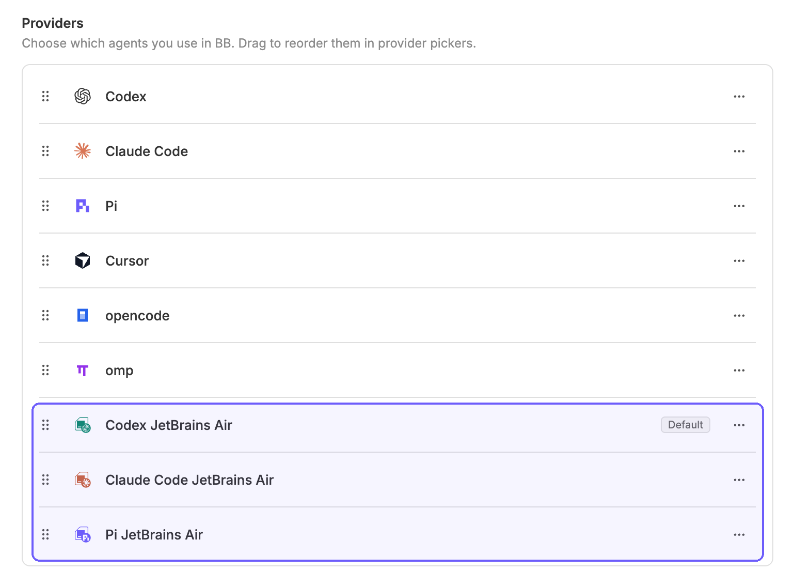

[](README.md)
[](README.ru.md)

# JetBrains Central for BB

> This is an unofficial plugin developed independently by an enthusiast. It is not an official JetBrains product.

Separate work AI providers in bb through JetBrains Central:

- **Codex JetBrains Air** — `central-codex`.
- **Claude Code JetBrains Air** — `central-claude-code`.
- **Pi JetBrains Air** — `central-pi`.



Each provider has its own icon: the JetBrains mark with a large, colored OpenAI (green), Claude (terracotta), or Pi (purple) badge. The JetBrains mark adapts to bb's light and dark themes; the plugin frontend renders the colored badges through the provider icon API. SVG files provide fallback icons for clients without the plugin frontend.

Select the provider you need when creating a thread. Personal Codex, Claude Code, and Pi remain separate options. The plugin does not change the project provider automatically: you explicitly choose a work profile.

## Requirements and installation

You need:

- bb >= 0.48 with Plugin SDK >= 0.6.104. Compatibility has been tested with SDK 0.6.104; repeat the checks below after updating bb because this plugin uses its bundled provider bridges.
- Git on the computer running the bb server, for installation from GitHub.
- Node.js on PATH, [JetBrains Central](https://www.jetbrains.com/help/central-cli/quickstart.html), and the CLIs for the agents you want to use on the machine running your threads.
- Central configured with your work access. Check that `central run codex`, `central run claude`, or `central run pi` works for the agents you need.

### Enable the bb command

The desktop app includes the `bb` CLI. To make it available in your regular terminal, open **Settings → General → Command line** in bb and use the install action. Open a new terminal afterward and check:

```sh
bb --version
```

This installs the command on the computer running the bb server. Commands run by agents inside bb already have access to it. You do not need to download a separate CLI or install an unrelated npm package named `bb`.

### Install from GitHub

Keep bb running, then run this in your terminal and confirm the installation:

```sh
bb plugin install https://github.com/SergeyZh/bb-plugin-jetbrains-central
```

bb downloads the source, installs the dependencies, and builds the plugin automatically. You do not need to clone the repository or run npm or build commands yourself. This source tracks the repository's default branch.

After installation, select **Codex JetBrains Air**, **Claude Code JetBrains Air**, or **Pi JetBrains Air** when creating a thread. Plugin settings are available under **Settings → Installed plugins → JetBrains Central**. The installed plugin ID is `jetbrains-central`.

### Updates

Check for and apply updates:

```sh
bb plugin outdated
bb plugin update jetbrains-central
```

Updates are manual. If an update cannot activate successfully, bb restores the previous version.

### Releases for maintainers

GitHub installation does not require downloadable release archives or committed `dist/` files: bb builds Git plugins during installation and updates. Publishing source commits is sufficient for users tracking the default branch.

For versioned releases, update `version` in `package.json` and `package-lock.json`, run the checks below, commit the changes, and publish a matching Git tag such as `v0.1.0`. A GitHub Release page is optional. Once that tag exists, new users can install a release range:

```sh
bb plugin install 'git:https://github.com/SergeyZh/bb-plugin-jetbrains-central.git@^0.1.0'
```

This range accepts compatible `0.1.x` releases when the user runs `bb plugin update jetbrains-central`. Publish each fix with a new version and tag; do not move existing release tags. Installing from npm instead would require publishing a package with prebuilt bundles; npm publication is not required for GitHub installation.

### Local installation for developers

Clone the repository, enter its directory, then run:

```sh
npm ci
bb plugin build
bb plugin install .
```

A local installation uses that directory in place, so keep it on disk. After editing the source, rebuild and run `bb plugin reload jetbrains-central`. Local installations do not receive GitHub updates through `bb plugin update`.

## How routing works

Each work profile launches its CLI through `central run <agent> -- …`. Central supplies tokens, proxies, and organization settings. The plugin uses Central's active access source (`central access`); switching the source affects subsequent work launches for all profiles. If Central fails, the plugin does not fall back to a personal account. Credentials are neither stored in plugin settings nor written to its log.

Codex, Claude Code, and Pi use the bridges bundled with the installed bb. The plugin loads their `experimental_providerBridge` export; bb files are neither modified nor copied. This is a compatibility adapter for the installed bb, not a public API for extending providers. Repeat the checks below after updating bb. Directory discovery supports macOS and typical global Node installations on Linux; you can specify another path explicitly.

Codex has its own `CODEX_HOME` in the plugin's data directory. Central adds `--profile`, which Codex 0.165.0 does not accept in `app-server` mode. The adapter transfers the profile created by Central into an isolated `config.toml`, preserves organization plugins/marketplaces/features, and passes connection settings without that flag. Your personal `~/.codex` is unchanged.

For Pi, the model catalog is requested from a process that has already loaded the Central extension. Available routes are `openai`, `anthropic`, and `google-vertex`, which the Central extension overrides. Personal and local Pi routes are hidden and rejected if selected explicitly.

The built-in providers' subagents and native memory are disabled for work profiles. Personal subscription limits are never reported as Central limits. Shared tools and project configuration are passed through bb's standard protocol. Additional built-in plugin interfaces, such as Codex Goals and specialized Codex cards, are not duplicated.

## Central credits

The plugin reads `central limit --json` on the machine running Central and exposes the active access source's allowance in two places:

- **Provider usage**: open the chart button at the bottom of the sidebar and select **central** on the relevant machine. Compact labels such as `193/200 cr.` show remaining credits and the limit; `(+)` marks top-up credits. The built-in **Provider usage** plugin must be enabled. A single Central resource covers Codex, Claude Code, Pi, and custom Central profiles.
- **Thread context**: Central threads show remaining credits, for example `Central: 193 / 200 credits left`, above the composer. Click it for balance details, the reset date, last update, and **Refresh credits**. When bb uses a context card, **Central credits** appears there with a refresh action and details in its tooltip.

Amounts are **credits**, including CLI fields named `usedDollars` and `maxDollars`; they are never sent to bb's USD cost fields. All credit amounts are rounded to whole numbers for display. Labels show remaining credits; Provider usage's percentage bar still indicates consumption. Main and nonempty top-up balances are separate; top-up credits have no assumed reset date. These are account allowances, not the cost of the current thread.

Reads share a 60-second cache per machine. Visible thread context refreshes every minute and after Central turns finish; manual refresh bypasses the cache. Transient errors retain the last measurement with a stale indication in thread context. Sign-in failures clear old balances. On another machine, install Central and run `central login` there; credentials remain managed by Central. Accounts on different machines are not merged by email.

## Settings

Settings → Installed plugins → JetBrains Central:

- `centralCommand`: path to Central; defaults to `central`.
- `builtinPluginsDirectory`: optional path to the installed bb's `builtin-plugins` directory **on the machine running the thread**.
- `profiles`: JSON array of work profiles.

After changing settings, run:

```sh
bb plugin reload jetbrains-central
```

A profile contains a permanent `id`, a `displayName`, the Central agent name (`agent`), a bridge (`bridge`), and additional agent CLI arguments (`args`). `runArgs` are passed to `central run` itself before the `--` separator: for example, `['--provider=openai']` for Copilot. Available bridges are `codex`, `claude-code`, `pi`, and `acp`. Do not change the ID of a profile that is already in use: thread history references it.

To connect an additional ACP agent, add a profile like this to the array alongside the existing profiles you need:

```json
{
  "id": "my-agent",
  "displayName": "My Agent JetBrains Air",
  "agent": "SUPPORTED_CENTRAL_AGENT_NAME",
  "bridge": "acp",
  "args": ["AGENT_SPECIFIC_ACP_FLAG"]
}
```

Replace the placeholders with an agent name from `central run --help` and the actual ACP arguments for its CLI. Central must support the agent, and the CLI must support ACP over stdin/stdout. The plugin does not add support for arbitrary agents to Central or install CLIs automatically. ACP transport is covered by a local protocol test; real Gemini, Junie, and Copilot integrations have not been tested separately.

## Verification

```sh
npm run typecheck
npm test
bb plugin build
bb provider models central-codex
bb provider models central-claude-code
bb provider models central-pi
```

Live smoke checks use the work subscription: they send exactly one short request without tools, verify the response, and check session resumption. They are not included in the regular `npm test` run.

```sh
npx tsx tests/live-native.ts codex
npx tsx tests/live-native.ts claude-code
npx tsx tests/live-native.ts pi
```

All three checks passed on the current machine with Central 2.1.0 and Codex 0.165.0.

## License

[MIT](LICENSE). Third-party marks and icon attribution are documented in [icons/README.md](icons/README.md).
