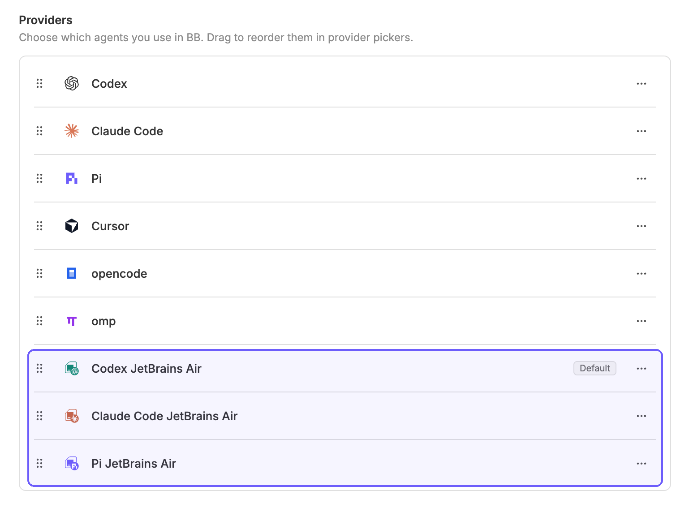

[](README.md)
[](README.ru.md)

# JetBrains Central for BB

Отдельные рабочие AI-провайдеры в bb через JetBrains Central:

- **Codex JetBrains Air** — `central-codex`.
- **Claude Code JetBrains Air** — `central-claude-code`.
- **Pi JetBrains Air** — `central-pi`.



У каждого провайдера своя иконка: знак JetBrains с крупным цветным значком OpenAI (зелёный), Claude (терракотовый) или Pi (фиолетовый). Знак JetBrains подстраивается под светлую и тёмную тему bb; цветные значки рисует фронтенд плагина через API иконок провайдеров. SVG-файлы служат запасными иконками для клиентов без фронтенда плагина.

Выберите нужный провайдер при создании диалога. Личные Codex, Claude Code и Pi остаются отдельными пунктами. Плагин не меняет провайдер проекта автоматически: выбор рабочего профиля остаётся явным.

## Требования и установка

Вам понадобятся:

- bb >= 0.48 с Plugin SDK >= 0.6.94. Совместимость проверена с SDK 0.6.94; после обновления bb повторите проверки ниже, поскольку плагин использует встроенные мосты провайдеров.
- Git на компьютере, где работает сервер bb, для установки из GitHub.
- Node.js на PATH, [JetBrains Central](https://www.jetbrains.com/help/central-cli/quickstart.html) и CLI нужных агентов на машине, где выполняются диалоги.
- Central с настроенным рабочим доступом. Убедитесь, что для нужных агентов работают команды `central run codex`, `central run claude` или `central run pi`.

### Как включить команду bb

CLI `bb` уже входит в десктопное приложение. Чтобы команда появилась в обычном терминале, откройте в bb **Settings → General → Command line** и воспользуйтесь действием установки. После этого откройте новый терминал и проверьте:

```sh
bb --version
```

Команда устанавливается на компьютере, где работает сервер bb. Агенты внутри bb уже имеют к ней доступ. Скачивать отдельный CLI или устанавливать посторонний npm-пакет с именем `bb` не нужно.

### Установка из GitHub

Оставьте bb запущенным, выполните в терминале команду и подтвердите установку:

```sh
bb plugin install https://github.com/SergeyZh/bb-plugin-jetbrains-central
```

bb сам скачает исходники, установит зависимости и соберёт плагин. Вручную клонировать репозиторий, запускать npm или сборку не требуется. Такая установка отслеживает основную ветку репозитория.

После установки выберите **Codex JetBrains Air**, **Claude Code JetBrains Air** или **Pi JetBrains Air** при создании диалога. Настройки плагина доступны в **Settings → Installed plugins → JetBrains Central**. ID установленного плагина — `central`.

### Обновления

Проверить и установить обновления:

```sh
bb plugin outdated
bb plugin update central
```

Обновления выполняются вручную. Если новая версия не сможет успешно запуститься, bb восстановит предыдущую.

### Выпуск версий для автора плагина

Для установки из GitHub не нужны архивы со сборкой или закоммиченный каталог `dist/`: bb собирает Git-плагины при установке и обновлении. Для пользователей, отслеживающих основную ветку, достаточно публиковать коммиты с исходниками.

Для выпуска версий обновите `version` в `package.json` и `package-lock.json`, выполните проверки ниже, закоммитьте изменения и опубликуйте соответствующий Git-тег, например `v0.1.0`. Страница GitHub Release необязательна. После появления такого тега новые пользователи смогут установить диапазон версий:

```sh
bb plugin install 'git:https://github.com/SergeyZh/bb-plugin-jetbrains-central.git@^0.1.0'
```

Такой диапазон позволяет получать совместимые версии `0.1.x` командой `bb plugin update central`. Для каждого исправления выпускайте новую версию и новый тег; не переносите существующие теги релизов. При установке из npm потребовалась бы публикация пакета с готовыми сборками, но для установки из GitHub публикация в npm не нужна.

### Локальная установка для разработчиков

Клонируйте репозиторий, перейдите в его каталог и выполните:

```sh
npm ci
bb plugin build
bb plugin install .
```

Локальная установка использует этот каталог напрямую, поэтому его нужно сохранить на диске. После изменения исходников пересоберите плагин и выполните `bb plugin reload central`. Локальные установки не получают обновления из GitHub через `bb plugin update`.

## Как устроена маршрутизация

Каждый рабочий профиль запускает CLI через `central run <agent> -- …`. Токены, прокси и организационные настройки предоставляет Central. Используется активный источник доступа Central (`central access`); переключение источника влияет на последующие рабочие запуски всех профилей. При ошибке Central плагин не переключается на личный запуск. Учётные данные не хранятся в настройках плагина и не выводятся в его журнал.

Codex, Claude Code и Pi используют мосты, поставляемые с установленным bb. Плагин загружает их экспорт `experimental_providerBridge`; файлы bb не изменяются и не копируются. Это адаптер совместимости с установленным bb, а не публичный API наследования провайдеров. После обновления bb стоит повторить проверки ниже. Автопоиск каталога поддерживает macOS и типовую глобальную установку Node на Linux; другой путь можно указать явно.

Для Codex выделен собственный `CODEX_HOME` в данных плагина. Central добавляет `--profile`, который Codex 0.165.0 не принимает в режиме `app-server`. Адаптер переносит созданный Central профиль в изолированный `config.toml`, сохраняет корпоративные plugins/marketplaces/features и передаёт параметры подключения без этого флага. Личный `~/.codex` не изменяется.

Для Pi каталог запрашивается у процесса с уже загруженным расширением Central. Доступны маршруты `openai`, `anthropic` и `google-vertex`, которые расширение Central переопределяет. Личные и локальные маршруты из Pi скрыты и отклоняются при явном выборе.

Вложенные агенты встроенных провайдеров и их нативная память выключены для рабочих профилей. Плагин не сообщает лимиты личной подписки как лимиты Central; отдельного индикатора квоты Central пока нет. Общие инструменты и конфигурация проекта передаются стандартным протоколом bb. Дополнительные интерфейсы встроенных плагинов, например Codex Goals и специальные карточки Codex, не дублируются.

## Настройки

Settings → Installed plugins → JetBrains Central:

- `centralCommand`: путь к Central, по умолчанию `central`.
- `builtinPluginsDirectory`: необязательный путь к каталогу `builtin-plugins` установленного bb **на машине выполнения**.
- `profiles`: JSON-массив рабочих профилей.

После изменения настроек выполните:

```sh
bb plugin reload central
```

Профиль содержит постоянный `id`, `displayName`, имя агента для Central (`agent`), мост (`bridge`) и дополнительные аргументы CLI агента (`args`). `runArgs` передаются самому `central run` перед разделителем `--`: например, `['--provider=openai']` для Copilot. Мосты: `codex`, `claude-code`, `pi`, `acp`. Не меняйте ID уже используемого профиля: на него ссылается история диалогов.

Дополнительного ACP-агента можно подключить профилем такого вида, включив его в массив вместе с нужными существующими профилями:

```json
{
  "id": "my-agent",
  "displayName": "My Agent JetBrains Air",
  "agent": "SUPPORTED_CENTRAL_AGENT_NAME",
  "bridge": "acp",
  "args": ["AGENT_SPECIFIC_ACP_FLAG"]
}
```

Замените заглушки именем агента из `central run --help` и реальными аргументами ACP его CLI. Central должен поддерживать агента, а CLI должен уметь ACP через stdin/stdout. Плагин не добавляет в Central поддержку произвольного агента и не устанавливает CLI автоматически. ACP-транспорт покрыт локальным протокольным тестом; реальные Gemini, Junie и Copilot отдельно не проверялись.

## Проверки

```sh
npm run typecheck
npm test
bb plugin build
bb provider models central-codex
bb provider models central-claude-code
bb provider models central-pi
```

Реальные smoke-проверки используют рабочую подписку: отправляют ровно один короткий запрос без инструментов, проверяют ответ и восстановление сессии. Не входят в обычный `npm test`.

```sh
npx tsx tests/live-native.ts codex
npx tsx tests/live-native.ts claude-code
npx tsx tests/live-native.ts pi
```

На текущей машине все три проверки успешно прошли с Central 2.1.0 и Codex 0.165.0.

## Лицензия

[MIT](LICENSE). Сведения о сторонних товарных знаках и источниках иконок приведены в [icons/README.md](icons/README.md).
